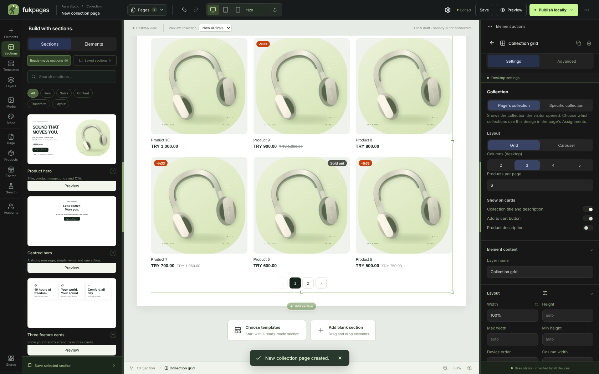
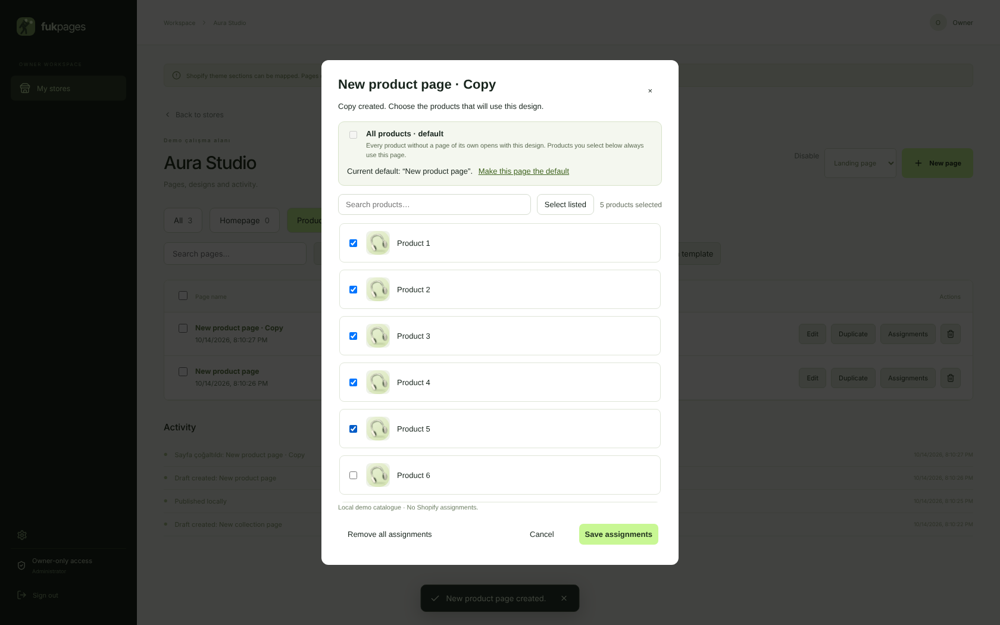

# Koleksiyon sayfası ve ürün/koleksiyon atamaları — 0.11.0

## Varsayılan sayfa ("Tüm ürünler" / "Tüm koleksiyonlar")

- Mağazanın **ilk ürün sayfası** kendiliğinden **tüm ürünlerin** varsayılan
  tasarımıdır; ilk koleksiyon sayfası da tüm koleksiyonların. Yani yeni bir
  ürün sayfası açınca her ürün bu tasarımla açılır.
- Bir ürün sayfasını **çoğaltınca** kopya varsayılanı almaz; atama penceresi
  açılır ve kopyaya istediğin ürünleri seçersin (ör. 5 ürün). Başka bir kopyaya
  5 başka ürün. Seçilmeyen tüm ürünler varsayılan sayfayla açılmaya devam eder.
- Bir ürünün kendi sayfası yayında değilse varsayılan sayfa gösterilir.
- Atama penceresinde: "Tüm ürünler · varsayılan" seçeneği, ürün/koleksiyon
  arama, görseller, "Listedekileri seç", seçili sayı ve
  **Varsayılanı bu sayfaya taşı**. Başka sayfada kullanılan ürünler kilitli
  görünür.
- Sayfa yönetiminde varsayılan sayfa "Tüm ürünler · varsayılan" etiketiyle
  görünür; varsayılan yoksa uyarı çıkar.
- Editör, ürün/koleksiyon sayfasını açarken sayfanın kendi ürününü/koleksiyonunu
  önizler (yoksa katalogdaki ilkini); üstteki önizleme listesinden
  değiştirilebilir.

## Koleksiyon vitrini

- Mağaza ürün listesi görünümü: koleksiyon görseli, başlığı ve açıklaması;
  ürün sayısı ve sıralama (Önerilen, fiyat artan/azalan, A–Z); kare görselli
  kartlar, indirim rozeti (-%33), tükendi rozeti, fiyat + üstü çizili fiyat,
  sepete ekle; numaralı sayfalama. Kart ve başlık ürün sayfasına bağlanır.
- Ayarlar (öğeyi seçince sağda): kaynak (sayfanın koleksiyonu / belirli
  koleksiyon), ızgara veya kaydırmalı, masaüstü 2–5 sütun (tablette en çok 3,
  mobilde 2), sayfa başına ürün, başlık/açıklama, sepete ekle ve ürün açıklaması.
- Boş koleksiyon sayfası ve "Koleksiyon sayfası" şablonu bu görünümü kullanır;
  şablondaki sabit "Koleksiyon adı" başlığı kaldırıldı, başlık açılan
  koleksiyondan gelir.
- Yerel katalog panelinde **8 örnek ürün ve 2 koleksiyon ekle** düğmesi
  atamaları denemek için örnek veri ekler (kaydetmeden önce görünür).

## Doğrulama

- `tests/page-lifecycle.test.mjs`: ilk ürün sayfası tüm ürünler için açılır,
  bilinmeyen ürün 404; kopya varsayılanı almaz, kendi ürünlerinde öne geçer
  (yayında değilse varsayılan kalır); varsayılan tek sayfadadır, `takeDefault`
  ile taşınır; koleksiyonlarda aynı kural.
- `python tests/browser_collections.py`: yeni koleksiyon sayfası varsayılan
  olur ve vitrin başlık, sayı, rozet ve sayfalamayla görünür; sütun, sayfa
  başına ürün, sıralama ve sepete ekle ayarı; yerel yayında başka koleksiyon
  ve 390 px'te taşma yok; ürün kopyasına 5 ürün atanır, diğerleri varsayılanda
  kalır; varsayılan tek tıkla taşınır.

