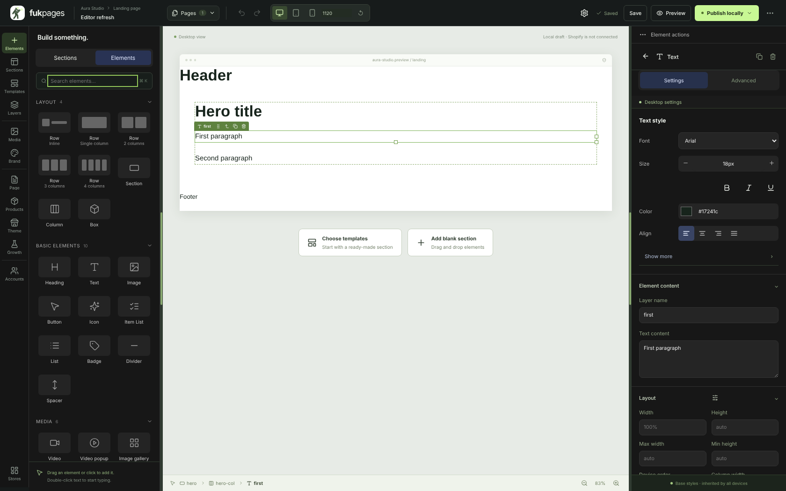
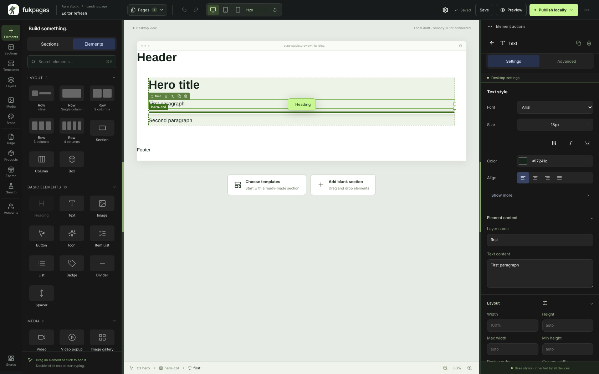
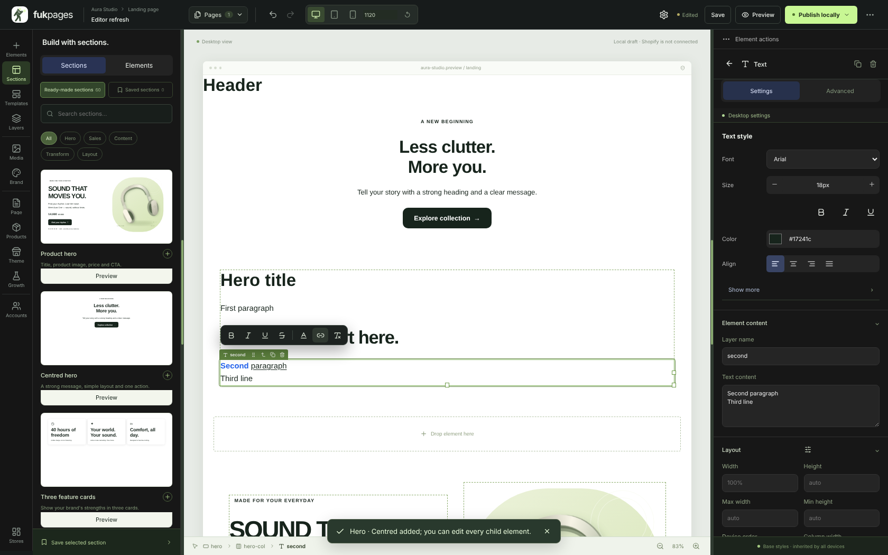

# Editör deneyimi — 0.7.0

Bu sürüm editörü GemPages tarzı çalışma akışına yaklaştırır: tek üst çubuk,
etiketli sol menü, sıkı öğe kütüphanesi, bırakılacak yeri tam gösteren çizgi,
bölümler arası ekleme, yüzen metin araç çubuğu ve tıklanabilir seçim yolu.
Yeni logo panel, giriş ekranı, editör ve favicon'da kullanılır.

| İstek | Davranış ve kanıt |
| --- | --- |
| Tek üst çubuk | İkinci sayfa çubuğu kaldırıldı. **Pages** açılır listesi sayfalar arasında geçer; **⋯** menüsü Page management, Duplicate page, ürün/koleksiyon atamaları, JSON dışa/içe aktarma ve başlangıç şablonlarını toplar. Escape menüyü kapatır, seçim korunur. Ürün/koleksiyon sayfalarında önizleme ürünü tuvalin üst satırındadır. |
| Etiketli sol menü | Her aracın kendi ikonu ve altında kısa adı var: Elements, Sections, Templates, Layers · Media, Brand · Page, Products, Theme, Growth · Accounts. Gruplar çizgiyle ayrılır; ipucu panelin ne içerdiğini söyler. |
| Öğe kütüphanesi | 50 öğe türünün her biri ayrı ikonla gösterilir (önceden 30 öğe aynı kutu ikonunu kullanıyordu). Gruplar: Layout, Basic, Media, Product, Conversion, Forms, Navigation & content, Advanced. Izgara en az üç kolon; arama Escape ile temizlenir. |
| Sürükle-bırak | İmlecin altındaki öğeden başlayarak hedef bulunur: yaprak öğeler üst/alt yarıya göre önüne/arkasına, kapsayıcılar imlecin konumundaki sıraya alır; kenar bandında kapsayıcının yanına bırakılır. Ekranda tek bir yeşil çizgi ve hedef adı görünür; bırakılan yer çizgiyle aynıdır. Düğme içine yalnızca metin/ikon/görsel girer; kilitli öğelere bırakılmaz. Bölümler yalnızca sayfa seviyesinde, header başta ve footer sonda kalacak şekilde yerleşir. |
| Bölüm ekleme | Bir bölümün üzerine gelince alt kenarında **+ Add section** belirir: **Choose a ready-made section** kütüphaneyi açar ve seçilen bölüm oraya eklenir; **Blank section** boş bölümü tam o konuma koyar. Footer'ın altında gösterilmez. |
| Yüzen metin araç çubuğu | Metne çift tıklayınca metnin hemen üstünde açılır: Bold, Italic, Underline, Strikethrough, metin rengi (marka renkleri + hazır renkler + özel renk), bağlantı ekle/düzenle/kaldır (Ctrl/Cmd+K) ve biçimi temizle. Enter aynı öğe içinde satır sonu ekler. Tuvaldeki bağlantıya tıklamak editörden çıkarmaz. |
| Güvenli zengin metin | Kayıtta biçim tek tipe çevrilir: `<strike>` → `<s>`, renkler hex, stiller yalnızca `span`'da. Bağlantılar http(s), `/yol`, `#bölüm`, mailto ve tel ile sınırlıdır; `javascript:` reddedilir, yeni sekme bağlantıları `noopener noreferrer` alır. Sunucu aynı kuralları uygular. |
| Seçim yolu | Alt çubuk seçili öğenin tüm üst katmanlarını gösterir (Section › Row › Column › Heading); tıklanan katman seçilir. Katman ağacı seçili öğenin üstlerini açar ve satırı görünür yapar. |
| Hata düzeltmeleri | Text content kutusu satır sonlarını koruyor ("SOUND THAT\nMOVES YOU."). Klavye kısayolları en güncel seçimi kullanıyor; yapıştırmadan hemen sonra Ctrl+D doğru öğeyi çoğaltıyor. |

## Kod düzeni

`Editor.tsx` 3.480 satırdan 2.900 satıra indi; tuval öğesi (`CanvasNode.tsx`), katman
ağacı (`LayerTree.tsx`), öğe kütüphanesi (`ElementLibrary.tsx`), sol menü
(`ToolRail.tsx`), metin araç çubuğu (`TextToolbar.tsx`), bölüm ekleme
(`SectionInsert.tsx`), seçim yolu (`Breadcrumb.tsx`) ve bırakma mantığı
(`dropTargets.ts`, `useCanvasDrop.ts`) ayrı dosyalarda. Bırakma kararı saf
fonksiyonlarla verildiği için birim testleriyle doğrulanır.

## Doğrulama

- `npm test`: 64 test. Yeni `tests/editor-canvas.test.ts` bırakma sırası,
  kenar/yarım kuralları, düğme/kilit sınırları, çizgi geometrisi, header/footer
  yerleşimi, seçim yolu, her öğenin tek grupta ve tek ikonla bulunması ve
  sunucu tarafı bağlantı/biçim temizliğini kontrol eder.
- `npm run test:editor`: gerçek Chromium'da üst çubuk/menü, sol menü,
  kütüphane, sürükleme sırasında çizginin konumu ve bırakılan yer, bölüm
  ekleme, metin araç çubuğu (kalın, renk, bağlantı, geçersiz bağlantı reddi,
  satır sonu), kayıt, yeniden açma, yerel yayın ve ziyaretçi sayfasındaki
  bağlantı. Üç ardışık çalıştırmada kararlı.
- Mevcut bütün tarayıcı testleri (`test:browser`, `test:ui`, `test:atomic`,
  `test:feedback`, `test:responsive`) geçer.

