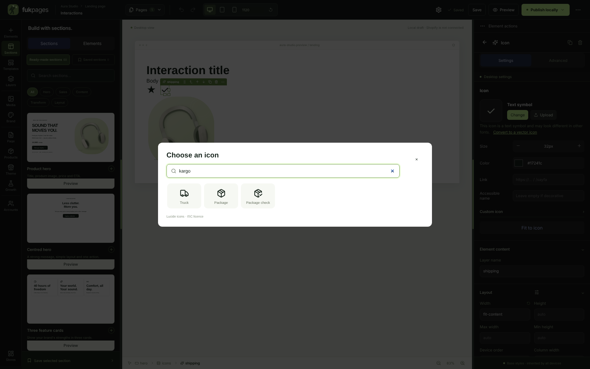
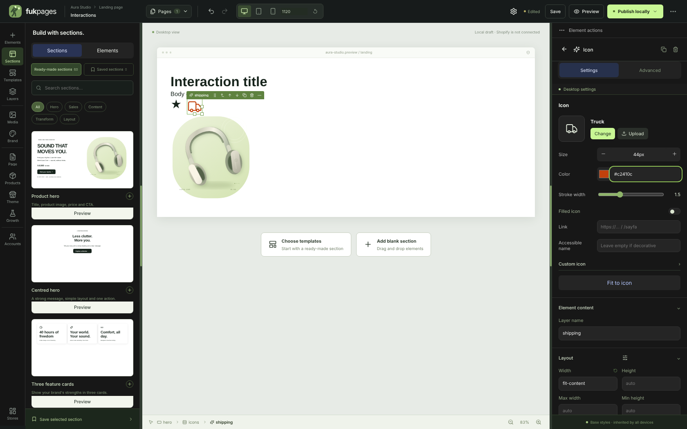
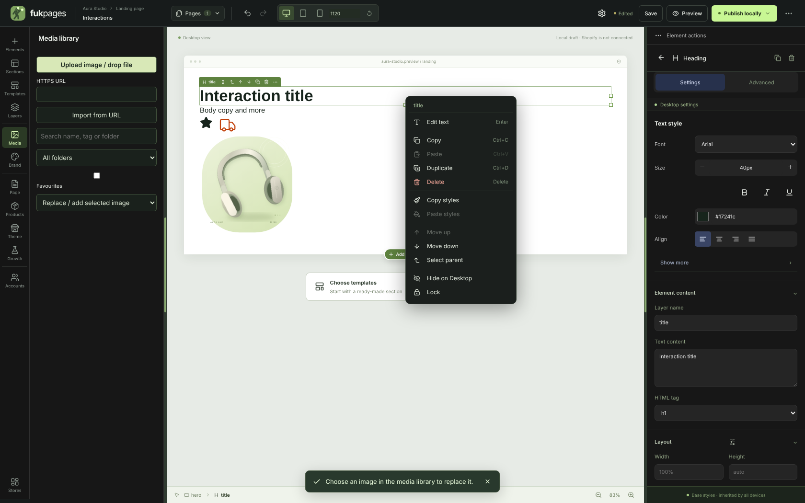

# Sayfa oluşturucu etkileşimleri ve vektör ikon kitaplığı — 0.10.0

## Tuvalde seçme ve düzenleme

- **Tek tık seçer, çift tık düzenler.** Tuvaldeki hiçbir öğe metin gibi
  seçilmez; ikon, görsel veya butona tıklayınca imleç ya da mavi metin vurgusu
  çıkmaz. Metin seçimi yalnızca bir metni düzenlerken açıktır.
- **Çift tık / Enter** öğenin asıl ayarını açar:
  - Başlık ve metin → satır içi düzenleme (imleç sona gelir); **Esc** çıkar.
  - İkon → **İkon kitaplığı** penceresi.
  - Görsel → **Medya** paneli ("Seçili görseli değiştir" modunda).
  - Buton → buton yazısı düzenlenir.
- **Delete / Backspace** seçili öğeyi siler; **Ctrl+Z** geri alır.

## Öğe araç çubuğu

Seçili öğenin üstünde: ad, sürükleme tutamacı, üst öğeye çık, **yukarı taşı**,
**aşağı taşı**, çoğalt (Ctrl+D), sil (Delete) ve **⋯ Diğer işlemler**. Sayfanın
en üstüne değen öğelerde araç çubuğu öğenin altına geçer.

## Sağ tık menüsü

Gruplanmış, ikonlu ve kısayollu: Metni düzenle / İkonu değiştir / Görseli
değiştir · Kopyala, Yapıştır, Çoğalt, Sil · Stili kopyala, Stili yapıştır ·
Yukarı taşı, Aşağı taşı, Üst öğeyi seç · Bu cihazda gizle, Kilitle/Kilidi aç.
Ok tuşlarıyla gezilir, Esc yalnızca menüyü kapatır (seçim kalır), pencere
kenarına taşmaz. Kullanılamayan işlemler pasif görünür.

## Vektör ikonlar

- 1.544 ikonluk **Lucide** kitaplığı (ISC lisansı). Gruplar: Popüler,
  E-ticaret, Güven ve kalite, Doğa ve sağlık, İletişim, Sosyal medya, Oklar,
  Medya ve teknoloji, Yaşam, Şekiller ve işaretler, Tümü.
- Arama Türkçe kelimeleri de anlar: "kargo" → kamyon, "kalp", "iade", "güvenli
  ödeme", "konum"… İngilizce adla da aranır.
- İkon ayarları: önizleme + **Değiştir** / **Yükle**, boyut, renk, çizgi
  kalınlığı, dolgulu ikon, bağlantı (+ yeni sekmede aç), erişilebilir ad, özel
  ikon URL'si ve "ikon rengini kullan". İkonlarda yazı tipi, kalın/italik gibi
  metin ayarları artık görünmez.
- Eski metin sembolü ikonlar (★ ✓ ∞ …) olduğu gibi görünmeye devam eder;
  ayarlarda **Vektör ikona dönüştür** ile karşılığına çevrilir (★ ve ♥ dolgulu
  kalır).
- Yeni ikon öğeleri, ikonlu liste, başlangıç sayfası, hazır bölümler ve
  şablonlardaki özellik/güven/iletişim ikonları vektördür. Yorum yıldızları ve
  buton yazısındaki oklar metin sembolü olarak kalır.
- İkon, sayfaya HTML olarak değil yalnızca çizim verisi olarak kaydedilir:
  izinli SVG şekilleri (path, circle, rect, line, polyline, polygon, ellipse) ve
  izinli sayısal öznitelikler. Sunucu başka her şeyi reddeder.
- Tam kitaplık (`/icons/lucide.json`, ~67 KB gzip) yalnızca ikon penceresi
  açılınca yüklenir; varsayılan ve şablon ikonları uygulamanın içindedir.
  Kitaplık yeniden üretmek için: `npm run icons` (lucide-react güncellenince).

## Doğrulama

- `tests/icons.test.ts`: kitaplıktaki her ikon güvenli; paketli ikonlar
  kitaplıkla aynı ve üretici `--check` temiz; script, olay, bağlantı, stil ve
  aşırı büyük veri reddedilir; sunucu vektör ikonu korur, boşu atar, güvensizi
  reddeder; yeni öğe, liste, şablon ve bölümler vektör ikon kullanır; arama
  Türkçe/İngilizce/kısmi adla bulur.
- `python tests/browser_interactions.py`: ikon tıklanınca metin seçimi yok,
  çift tıkta kitaplık açılır, "kargo" araması kamyonu ilk sırada gösterir;
  boyut, renk, çizgi kalınlığı; sembolün dolgulu vektöre dönüşmesi; Enter ile
  metin düzenleme ve Esc; görselde çift tıkla medya; araç çubuğunda
  yukarı/aşağı; sağ tık menüsünde odak, pasif işlemler, Esc, çoğalt, gizle;
  Delete + geri al; kayıt, yeniden açma ve yerel yayında SVG.

