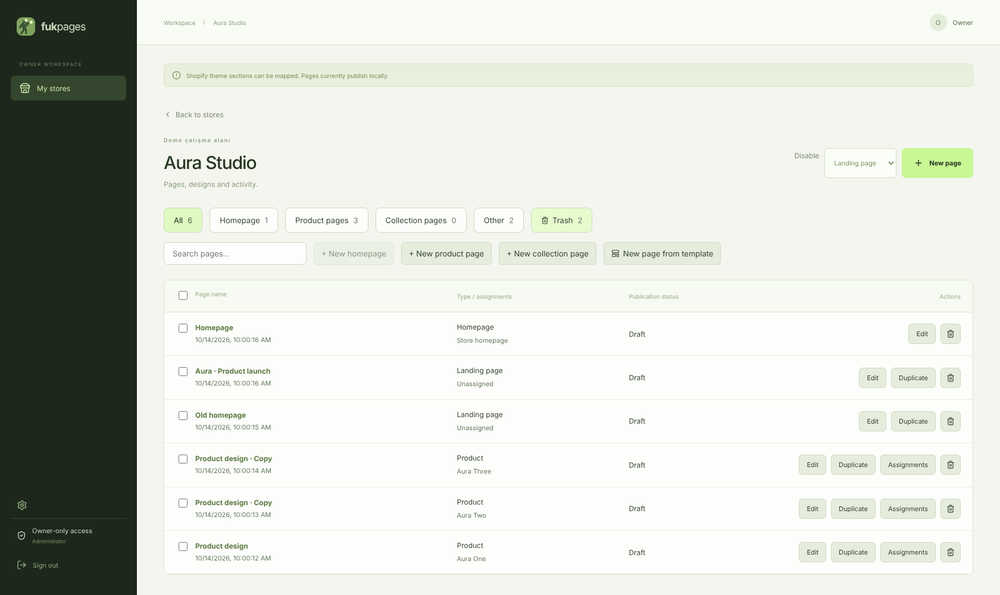
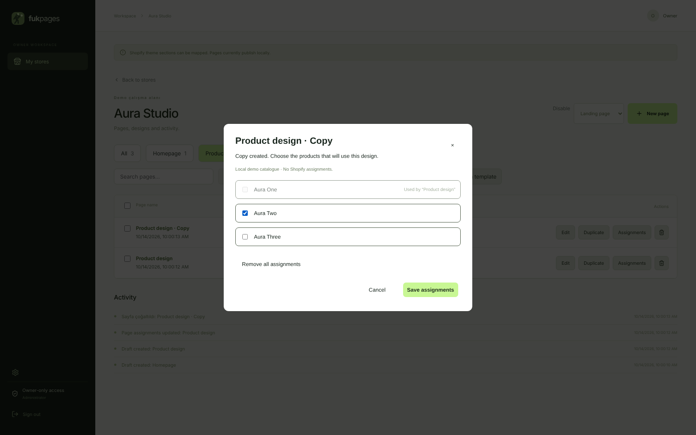
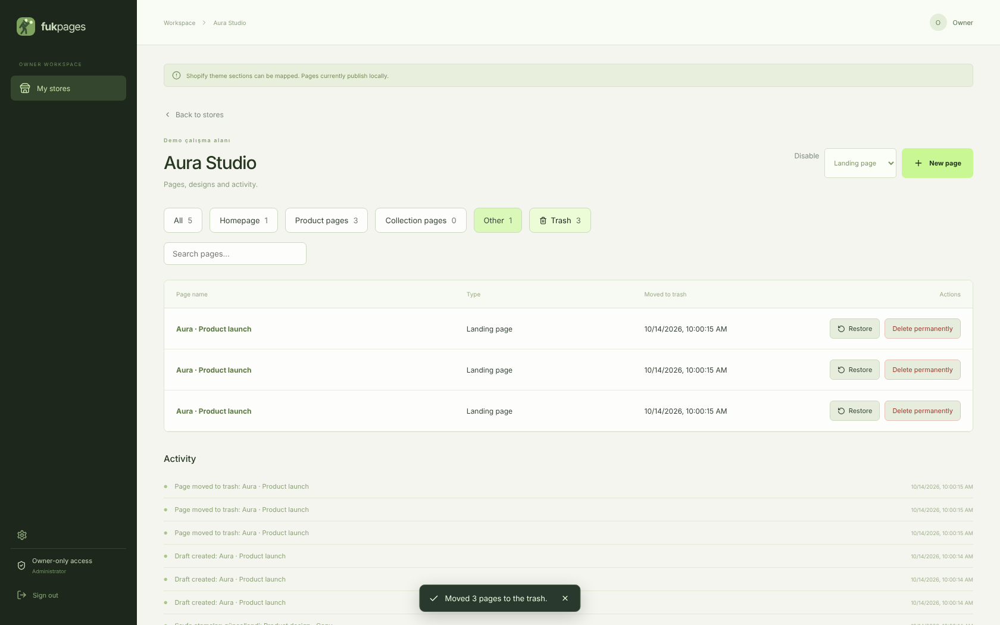

# Tek ana sayfa, güvenli çoğaltma ve çöp kutusu — 0.9.0

## Kurallar

- **Her mağazada tek ana sayfa olur.** İkinci ana sayfa oluşturma, ana sayfayı
  çoğaltma, başka bir sayfanın türünü ana sayfa yapma, başka mağazadan ana sayfa
  aktarma ve çöp kutusundan ikinci bir ana sayfayı geri yükleme sunucuda
  reddedilir (`409`, `code: "single-home"`). Arayüzde bu seçenekler pasiftir.
- Mağazanın tek ana sayfası kendiliğinden mağazanın **home** hedefine atanır;
  ayrıca atama yapmak gerekmez.
- **Ürün, koleksiyon, açılış ve standart sayfalar çoğaltılabilir.** Ürün veya
  koleksiyon sayfası çoğaltıldığında atama penceresi hemen açılır: başka
  sayfada kullanılan ürünler/koleksiyonlar kilitli görünür ("“…” sayfasında
  kullanılıyor"), kopyaya yeni ürünler seçilir. Kopya taslaktır ve adı arayüz
  diline göre "· Kopya / · Copy" ile biter.
- Bir sayfanın türü değişince eski türe ait atamalar bırakılır (ör. ürün
  sayfası açılış sayfasına dönerse ürün ataması boşalır).

## Panelde değişenler

- Mağaza kartındaki **Editörü aç / Open editor** artık her tıklamada yeni sayfa
  oluşturmaz: mağazanın ana sayfasını, yoksa en son sayfayı açar. Yalnızca hiç
  sayfası olmayan mağazada ana sayfayı oluşturur. (Eski davranış her tıklamada
  yeni bir "Aura · Product launch" taslağı ekliyordu.)
- **Yeni sayfa** türü listesinde ana sayfa "(zaten var)" olarak pasiftir.
- Editörün ⋯ menüsünde ana sayfa için **Sayfayı çoğalt** pasiftir.
- Sayfa yönetiminde:
  - **Çöp kutusu** sekmesi: geri yükle veya kalıcı olarak sil (onaylı).
  - Satır seçimi ve toplu **Çöp kutusuna taşı**.
  - Eski verilerde birden fazla ana sayfa varsa uyarı bandı çıkar. Atanmış (yoksa
    yayında, yoksa en son düzenlenen) olan ana sayfa olarak kalır; diğerleri
    **Fazladan ana sayfa** etiketiyle gösterilir ve tek tıkla **Açılış sayfasına
    dönüştür** ya da çöp kutusuna taşınabilir. Mevcut sayfalar otomatik silinmez.
- İşlem geçmişi kayıtları seçili arayüz diline çevrilir.

## Çöp kutusu

- Çöp kutusuna taşınan sayfa listelerden, editörden ve tüm herkese açık
  adreslerden kalkar; yerel yayını biter, ürün/koleksiyon atamaları ve
  zamanlamaları boşalır. Sürüm geçmişi, yayın geçmişi ve form kayıtları korunur.
- Geri yüklenen sayfa taslak olarak, atamasız döner; sürüm numarası artar, açık
  kalmış eski bir editör sekmesi üzerine yazamaz.
- Kalıcı silme tasarımı, sürüm ve yayın geçmişini ve ölçümleri siler; form
  kayıtları müşteri kaydı olduğu için kalır. Geri alınamaz.
- Görüntüleyici rolü çöp kutusunu görebilir ama taşıyamaz, geri yükleyemez,
  silemez. Devre dışı mağazada değişiklik yapılamaz.

## API

| İstek | Açıklama |
| --- | --- |
| `POST /api/pages/:id/trash` | Sayfayı çöp kutusuna taşır |
| `GET /api/stores/:id/trash` | Çöp kutusundaki sayfalar |
| `POST /api/stores/:id/trash/:pageId/restore` | Geri yükler (ana sayfa kuralı geçerli) |
| `DELETE /api/stores/:id/trash/:pageId` | Kalıcı olarak siler |
| `POST /api/pages/:id/duplicate` `{ name? }` | Ana sayfa dışında çoğaltır |

## Doğrulama

- `tests/page-lifecycle.test.mjs`: ikinci ana sayfa, ana sayfa çoğaltma, türü
  ana sayfaya çevirme ve ana sayfa aktarımı reddedilir; tek ana sayfa otomatik
  atanır; ürün sayfası iki kez çoğaltılıp farklı ürünlere atanır ve doğru
  adreste yayınlanır; tür değişince atama bırakılır; çöp kutusu listelerden,
  editörden ve herkese açık adreslerden çıkarır, geri yükleme taslak ve atamasız
  döner, ana sayfa varken eski ana sayfa geri yüklenemez, kalıcı silme geçmişi
  temizler; eski veride iki ana sayfadan biri taşınınca diğeri ana sayfa olur;
  görüntüleyici ve devre dışı mağaza değişiklik yapamaz.
- `python tests/browser_pages.py`: **Open editor** üç kez açılınca tek ana sayfa
  kalır; ana sayfa seçenekleri pasif; ürün kopyası atama penceresiyle açılır ve
  kullanılan ürün kilitli; editör menüsünden kopya; eski fazladan ana sayfa
  uyarısı ve dönüştürme; toplu çöp kutusu, geri yükleme, kalıcı silme; ana sayfa
  çöpe gidince yenisi oluşturulur ve eskisi geri yüklenemez; tablo 1680–760 px
  arasında hizalı ve yatay kaydırmasız.

