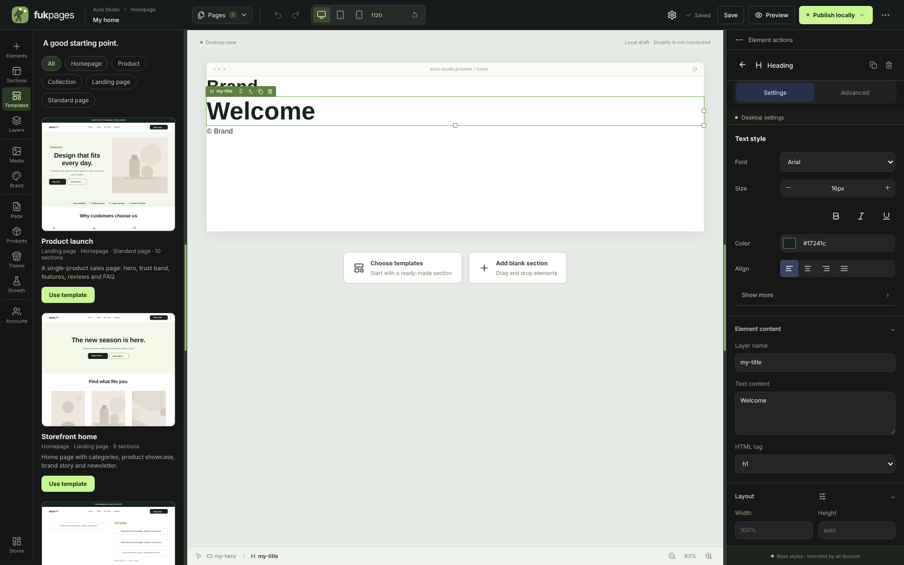
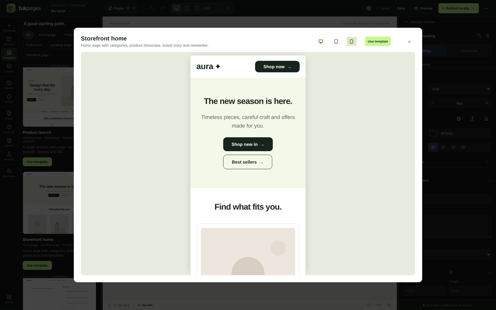
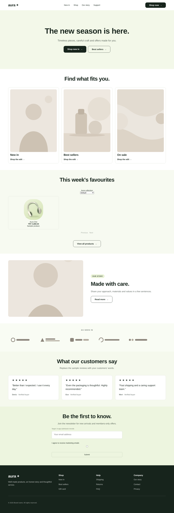

# Tam sayfa şablonları ve sürükleme boşluğu — 0.8.0

## Şablonlar

Sol menüdeki **Templates** paneli ve **Page management → New page from
template** aynı sekiz tam sayfa şablonunu kullanır:

| Şablon | Sayfa türü | Bölümler |
| --- | --- | --- |
| Product launch / Ürün lansmanı | Landing, ana sayfa, sayfa | Duyuru, header, hero, güven bandı, özellikler, hikâye, yorumlar, SSS, bülten, footer |
| Storefront home / Mağaza ana sayfası | Ana sayfa, landing | Header, ortalanmış hero, kategoriler, ürün vitrini, hikâye, logolar, yorumlar, bülten, footer |
| Classic product page / Klasik ürün sayfası | Ürün | Galeri + varyant + adet + sepete ekle, güven bandı, sekmeli ayrıntılar, teknik özellikler, karşılaştırma, yorumlar, SSS, ilgili ürünler |
| Story-led product page / Hikâye anlatan ürün sayfası | Ürün, landing | Satın alma alanı, önce/sonra, üç adım, paket teklif, yorumlar, SSS |
| Collection page / Koleksiyon sayfası | Koleksiyon | Koleksiyon başlığı, sayfaya bağlı ürün listesi, güven bandı, bülten |
| Sale campaign / Kampanya sayfası | Landing, ana sayfa | Geri sayımlı kampanya, ürün vitrini, paket teklif, yorumlar, SSS |
| About us / Hakkımızda | Sayfa, landing | Hero, hikâye, değerler, ekip, logolar, iletişim formu |
| Contact / İletişim | Sayfa | İletişim bilgileri ve formu, SSS |

- Her bölüm sıradan, bağımsız düzenlenebilir öğelerden oluşur ve marka kitine
  bağlıdır: renkler, fontlar, başlık ölçüleri, köşe ve bölüm boşluğu Global
  Styles değişince güncellenir. Tablet ve mobil ayarları hazırdır.
- Metinler şablonun kullanıldığı anki arayüz diline göre gelir (Türkçe/İngilizce);
  sonrasında müşterinin içeriğidir.
- Ürün şablonları sayfaya atanan ürünü, koleksiyon şablonu atanan koleksiyonu
  gösterir. Vitrin ve paket bölümleri yerel katalogdaki ilk koleksiyon/ürünlere
  bağlanır.
- Galeride türe göre filtre, canlı küçük önizleme ve masaüstü/tablet/mobil tam
  önizleme vardır. İçeriği olan sayfada **Replace the page** veya **Add its
  sections to the end** seçilir; ekleme sayfanın kendi header/footer'ını korur.
  İkisi de Ctrl+Z ile geri alınır ve yayındaki sayfa yeniden yayınlanana kadar
  değişmez. Shopify tema düzeni kullanan sayfada şablonun header/footer'ı eklenmez.
- Örnek görseller ve logolar `public/assets/templates` altında, uygulamayla
  birlikte gelir.

## Sürükleme sırasında boşluk

Sürüklerken çizginin üzerinde, öğeyi alacak düzenin öğeler arası boşluğu
(px) küçük bir rozetle görünür; örneğin kolon gap'i 28 ise **28**. Boşluğu
olmayan düzenlerde rozet gösterilmez.

## Doğrulama

- `tests/page-templates.test.ts`: her şablon sunucu doğrulamasından blok veya
  stil kaybetmeden geçer; header başta, footer sonda, tek h1 ve her kullanımda
  yeni kimlikler; medya dosyaları mevcut; metin arayüz diline uyar; ürün ve
  koleksiyon blokları gerçek veriye bağlanır; ekleme mevcut header/footer'ı korur.
- `npm run test:templates`: galeri filtreleri ve canlı küçük önizlemeler, mobil
  önizleme, sona ekleme + geri alma, değiştirme + kayıt, şablondan yeni ürün
  sayfası ve sekiz şablonun 390/768/1280 px yerel yayında yatay taşma, bozuk
  görsel, birden fazla h1 ve çözümsüz ürün bloğu olmadan açılması.
- `npm run test:editor`: sürüklemede boşluk rozetinin değeri.

